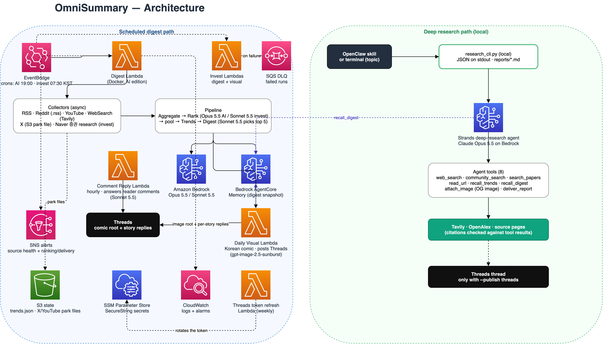
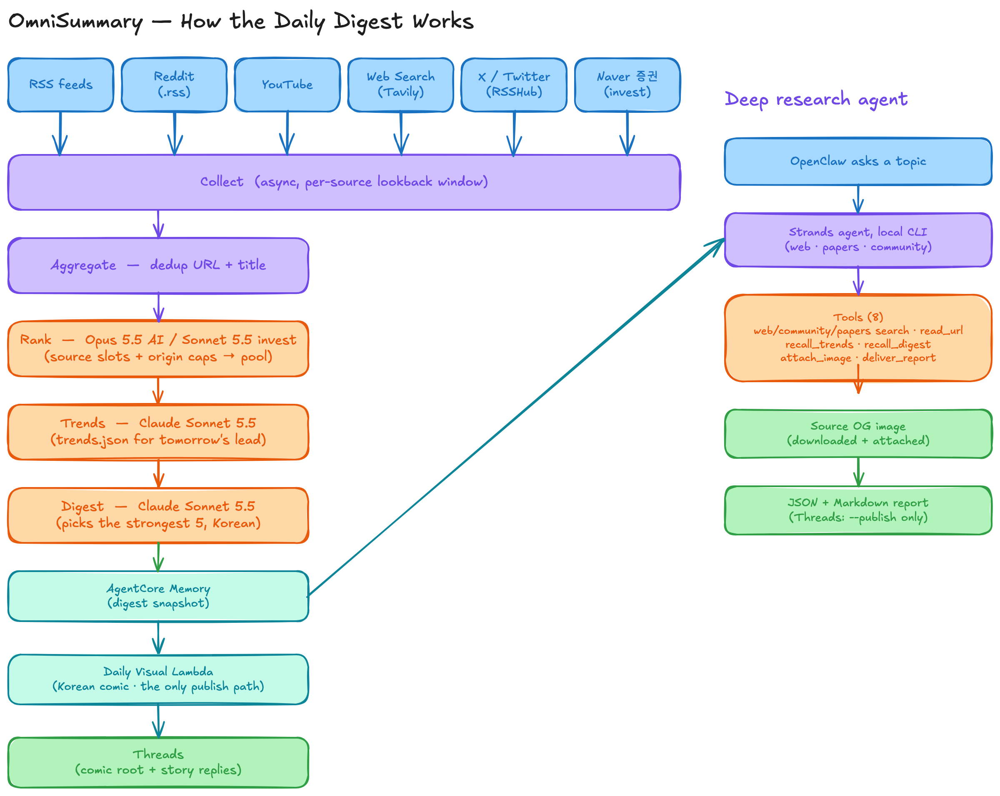

<div align="center">

# OmniSummary

**AI/ML 소식을 한국어 다이제스트와 헤드라인 만화로 Threads에 매일 올리고, 출처를 단 리포트를 쓰는 딥 리서치 CLI를 함께 제공한다.**

AWS · Amazon Bedrock(Claude, GPT) · Bedrock AgentCore Memory

[](https://github.com/bits-bytes-nn/omnisummary/actions/workflows/ci.yml)


[English README](./README.md) · [운영 가이드](./docs/operations.md) · [설계 문서](./docs/design.md)



</div>

## 하는 일

- **데일리 다이제스트(AWS, 정기 실행).** RSS와 Substack, Reddit, YouTube, X, 웹 검색에서 AI 소식을 모아 채점하고, 에디터 모델이 가장 좋은 기사 다섯 개를 고른다. 한국어 다이제스트를 쓰고 헤드라인을 한국어 만화로 그려 Threads 스레드 하나로 올린다. 첫 글에는 만화와 리드, 나머지 기사 제목이 들어가고 기사마다 답글이 하나씩 달린다.
- **딥 리서치(로컬 CLI).** 주제를 주면 에이전트가 웹과 논문, 커뮤니티 논의를 읽고 다이제스트와 같은 말투로 출처를 단 한국어 리포트를 쓴다. 결과는 JSON 한 개로 출력하고, Threads 게시는 `--publish threads`를 줄 때만 한다.
- **댓글 답글(선택).** 한 시간마다 최근 일주일 게시물의 독자 댓글에 답한다. 링크, 도메인, 핸들, 해시태그가 들어간 답글은 게시하지 않는다.



## 빠른 시작

Python 3.12 이상과 [uv](https://docs.astral.sh/uv/), `aws.bedrock_region`(기본 `us-west-2`)의 Bedrock에 접근할 수 있는 AWS 자격 증명이 필요하다. Docker는 X 수집과 배포에만 쓴다.

```bash
git clone <repo-url> && cd omnisummary
uv sync --extra dev
cp config/config-template.yaml config/config.yaml
cp .env.template .env      # TAVILY_API_KEY를 채운다

uv run python main.py --dry-run --sources web_search   # 다이제스트를 출력만 하고 저장도 게시도 하지 않는다
```

처음부터 동작하는 소스는 웹 검색뿐이다. 나머지는 하나씩 켠다.

| 원하는 것 | 설정 |
|-----------|------|
| RSS, Reddit, YouTube | `config.yaml`의 피드, 서브레딧, 채널(`YOUTUBE_API_KEY`는 선택) |
| X 게시물, YouTube 자막 | [로컬 동기화](#x와-youtube의-로컬-동기화)(둘 다 데이터센터 IP를 막는다) |
| 데일리 만화 | `OPENAI_API_KEY` |
| Threads 게시 | `THREADS_ACCESS_TOKEN`, `THREADS_USER_ID`, `pipeline.enable_threads_post: true` |
| 댓글 답글 | Threads 자격 증명과 `pipeline.enable_comment_replies: true` |

## 사용법

```bash
# 다이제스트
uv run python main.py --dry-run --sources rss reddit   # 출력만
uv run python main.py                                  # 저장, 만화, 게시(켜져 있을 때)

# 딥 리서치: stdout에 JSON 한 개, 리포트는 reports/ 아래
uv run python research_cli.py "<주제>"
uv run python research_cli.py "<주제>" --publish threads           # threads-preview는 게시하지 않는다
uv run python research_cli.py "<주제>" --edition invest            # 시장, 주식, 가상화폐

# 다이제스트가 이미 게시한 내용(무료, 읽기 전용)
uv run python recall_cli.py digest 2026-10-26
uv run python recall_cli.py trends
```

| `main.py` 옵션 | 효과 |
|----------------|------|
| `--sources ...` | `rss reddit youtube web_search rsshub naver_research` 중 이 소스만 수집한다(`rsshub`이 X, `naver_research`가 투자판의 국내 증권사 리서치) |
| `--dry-run` | 다이제스트를 출력만 하고 저장도 게시도 하지 않는다 |
| `--top-n 5` | 기사 개수 |
| `--date 2026-03-28` | 다이제스트 날짜(기본: `aws.timezone` 기준 오늘) |
| `--pin-url <url> [...]` | 이 URL을 기사에 반드시 넣는다 |
| `--force-republish` | 이미 게시한 날짜를 다시 게시한다 |

`main.py`는 수집이 0건이거나, 다이제스트가 만들어지지 않았거나, 게시가 다 올라가지 않으면 1로 끝난다.

> **로컬 전체 실행도 운영 데이터에 기록된다.** 스냅샷은 배포된 AgentCore Memory에 저장된다. `aws.state_bucket_name`에 스택의 버킷 이름을 넣어 원장을 공유한다. 넣지 않으면 운영에서 게시한 기록을 보지 못해 같은 날이 두 번 올라갈 수 있다.

## 설정

비밀값이 아닌 설정은 모두 `config/config.yaml`에 둔다. 모든 섹션이 모르는 키를 거부하므로 코드에서 없어진 키는 설정 파일에서도 지운다. 모든 필드 설명은 [design.md §3](docs/design.md#3-설정)에 있다.

### 판

같은 코드가 여러 판을 돌린다. 투자판(주식, 거시, 가상자산, 국내 부동산)은 07:30 KST에, AI/ML판은 19:00 KST에 돈다. 투자판을 돌리려면 `cp config/invest-template.yaml config/invest.yaml`로 설정을 만들고 `OMNISUMMARY_EDITION=invest`를 둔다(CLI는 `--edition invest`). 같은 Threads 계정에 올리지만 S3 접두사(`omnisummary/invest`)와 Lambda는 따로 쓴다.

### 모델

모든 LLM 단계는 Bedrock의 Converse API로 돌고, `shared/constants.py`의 ID(Claude, 또는 GPT `openai.gpt-6.1-sol` / `-terra`)를 받는다. 근거와 측정값은 [design.md §6](docs/design.md#모델-팩토리)에 있다.

| 단계 | 설정 키 | 기본값 |
|------|---------|--------|
| 랭킹 | `pipeline.ranking_model` | Sonnet 5.5(AI판 설정은 Opus 5.5) |
| 다이제스트, 그라운딩, 만화, 댓글 답글, 리서치 사실 확인 | `pipeline.digest_model` | Sonnet 5.5 |
| 트렌드 | `pipeline.trend_model` | Sonnet 5.5 |
| 검색어 다듬기 | `collectors.web_search.refine_model` | Sonnet 5.5 |
| 딥 리서치 | `agent.model_id` | Opus 5.5 |
| 만화 이미지 | `pipeline.image_model` | `gpt-image-2.5-sunburst` |

### 비밀값

로컬에서는 `.env`, AWS에서는 SSM Parameter Store에 둔다. 꼭 필요한 것은 Tavily뿐이고, 키가 없는 기능은 로그 한 줄을 남기고 건너뛴다.

| 변수 | 켜는 기능 |
|------|-----------|
| `TAVILY_API_KEY` | 웹 검색과 리서치 CLI의 검색 |
| `YOUTUBE_API_KEY` | YouTube Data API(없으면 채널 RSS) |
| `OPENAI_API_KEY` | 데일리 만화 |
| `THREADS_ACCESS_TOKEN`, `THREADS_USER_ID` | Threads 게시(AWS에서는 매주 갱신) |
| `ALERT_EMAIL` | 이메일 알림. 배포에 필요하다 |
| `S3_SYNC_ACCESS_KEY_ID`, `S3_SYNC_SECRET_ACCESS_KEY` | 무인 로컬 동기화용 키(선택) |

### RSSHub로 X 읽기

X는 로컬 [RSSHub](https://docs.rsshub.app/) 컨테이너로 읽는다. 로그인한 x.com 세션의 `auth_token`과 `ct0` 쿠키가 필요하고, 없으면 피드가 빈 채로 돌아온다.

```bash
docker run -d --name rsshub --restart unless-stopped -p 1200:1200 \
  -e NODE_ENV=production -e CACHE_TYPE=memory \
  -e TWITTER_AUTH_TOKEN='<auth_token>' -e TWITTER_CT0='<ct0>' \
  diygod/rsshub:latest
```

## 다이제스트가 만들어지는 과정

1. **수집.** 수집기가 동시에 돌고 상태(`OK`, `EMPTY`, `FAILED`, `STALE`, `DEGRADED`)를 보고한다. X와 YouTube 자막은 로컬에서 모아 S3에 적재하고 Lambda가 읽는다.
2. **중복 제거.** 정규화한 URL과 제목으로 맞추고 더 나은 쪽을 남긴다.
3. **랭킹.** 랭킹 모델이 채점하고 홍보성 글과 빈약한 글을 거른다. 후보 풀은 `top_n + digest_candidate_buffer`개이고, 채널, 작성자, 사이트마다 `max_per_origin`개까지만 받는다.
4. **작성.** 에디터가 가장 좋은 기사 `top_n`개를 골라 리드와 기사별 제목, 본문, 시사점을 쓴다. 그라운딩 단계가 주장마다 원문과 대조한다.
5. **트렌드 추적.** 작성이 끝난 뒤(dry run에서는 건너뛴다) 모델이 그날 기사를 트렌드로 분류만 하고, 날짜와 상태는 `trends.json`을 다루는 Python 코드가 맡는다.
6. **렌더링.** 게시물 형태는 프롬프트가 아니라 코드가 정하고, Threads의 500자 한도를 지킨다.
7. **만화와 게시.** 별도 Lambda가 헤드라인을 한국어 만화로 그리고 스레드를 올린다. 만화가 실패해도 글은 나간다.

단계별 상세와 설계 이유는 [design.md](docs/design.md)에 있다.

## 딥 리서치

`research_cli.py`는 도구 8개를 쓰는 Strands 에이전트를 돌린다. `web_search`, `community_search`(Reddit, X, HN, Substack), `search_papers`(OpenAlex), `read_url`, `recall_trends`, `recall_digest`, `attach_image`, `deliver_report`다.

공개하기 전에 `deliver_report`가 검사한다. 인용한 URL이 모두 도구 호출 결과에서 나왔는지, 별도 모델이 보기에 주장마다 출처가 뒷받침하는지, Threads 한도 안에 드는지, 이미지가 인용한 페이지의 것인지 본다. 검사에 걸리면 고쳐 쓰도록 돌려보낸다.

OpenClaw 스킬(`~/Projects/agent-config/skills/omnisummary-research/SKILL.md`)이 JSON 결과를 전달한다. 주요 필드는 `status`, `title`, `markdown`, `markdown_path`, `sources`, `threads`, `usage`, `error`다. 두 CLI의 종료 코드는 `0` 성공, `1` 실패, `2` 입력 거부이고 로그는 stderr로 나간다.

## 운영

[docs/operations.md](docs/operations.md)가 운영 가이드다. 하루 일정, 알림마다 뜻과 실행할 명령, 실패한 날을 저장된 스냅샷으로 다시 올리는 방법, 하지 말 것을 정리했다.

## AWS 배포

### 첫 배포

`config/config.yaml`과 `.env`의 `ALERT_EMAIL`이 필요하고, `<region>`은 `aws.region`과 같아야 한다. 전역 `cdk`가 아니라 저장소에 고정한 CDK CLI(`npx cdk`)를 쓴다. ECR 저장소를 foundation 스택이 만들기 때문에 foundation을 먼저 배포한다.

```bash
npm install
# 1~3단계(CDK, aws, docker login)는 셸의 프로필을 쓰고, 4단계 스크립트는 aws.profile을 읽는다.
# 두 쪽이 같은 계정을 가리키게 <profile>에 aws.profile 값을 넣는다.
export AWS_PROFILE=<profile>

# 1. bootstrap과 foundation 스택(아직 이미지가 없다)
export FOUNDATION_ONLY=1
npx cdk bootstrap -a "uv run python scripts/deploy.py"
npx cdk deploy '*-foundation' -a "uv run python scripts/deploy.py"
unset FOUNDATION_ONLY   # application 스택이 생긴 뒤에는 설정하지 않는다

# 2. 이미지 빌드와 푸시
ECR_URI="$(aws sts get-caller-identity --query Account --output text).dkr.ecr.<region>.amazonaws.com/omnisummary-<stage>-agent"
aws ecr get-login-password --region <region> | docker login --username AWS --password-stdin "${ECR_URI%%/*}"
docker build --platform linux/amd64 --provenance=false -t "${ECR_URI}:latest" . && docker push "${ECR_URI}:latest"

# 3. 이미지의 sha256 digest로 고정해 배포
export DIGEST_IMAGE_REF=$(aws ecr describe-images --region <region> --repository-name omnisummary-<stage>-agent \
  --image-ids imageTag=latest --query 'imageDetails[0].imageDigest' --output text)
npx cdk deploy --all -a "uv run python scripts/deploy.py"

# 4. 비밀값과 비용 추적
uv run python scripts/put_secrets.py              # 읽기 전용 확인은 --verify
uv run python scripts/put_inference_profiles.py   # 단계의 모델을 바꾼 뒤에도 다시 실행
```

### 이후 배포

```bash
scripts/release.sh
```

푸시했고 CI가 통과한 `main`의 HEAD를 빌드, 푸시, 배포한다. 작업 트리가 깨끗하지 않거나, 푸시하지 않았거나, CI가 실패했으면 거부한다. 계정은 셸의 `AWS_PROFILE`이 아니라 설정의 `aws.profile`로 정한다.

### 만들어지는 리소스

| 리소스 | 용도 |
|--------|------|
| Lambda: digest | 수집, 랭킹, 작성(매일, `aws.digest_cron_hour`는 UTC 기준) |
| Lambda: visual | 만화를 그리고 Threads에 게시한다. 유일한 게시 경로 |
| Lambda: 토큰 갱신 | 매주 Threads 토큰을 갱신한다 |
| Lambda: 댓글 답글 | 매시간 |
| AgentCore Memory | 날짜마다 다이제스트 스냅샷 하나 |
| S3, SSM, SQS, SNS, CloudWatch, ECR | 상태, 비밀값, DLQ, 알림과 알람, 이미지 |

모든 Lambda는 `retry_attempts=0`으로 돈다. Threads에는 멱등 키가 없어 재시도하면 두 번 올라갈 수 있다. 비용은 태그를 단 추론 프로필과 호출마다 남기는 `usd=` 로그로 나눠 보고, `uv run python scripts/cost_report.py --days 7 [--by stage]`로 합산한다.

> **SSM 비밀값 파라미터의 템플릿 속성은 추가하거나 바꾸지 않는다.** CloudFormation이 실제 비밀값 위에 자리표시자를 다시 쓴다.

### X와 YouTube의 로컬 동기화

X와 YouTube 자막은 데이터센터 IP를 막으므로 다이제스트 직전에 로컬에서 동기화한다. X를 쓰려면 `collectors.rsshub.enabled: true`와 `accounts`를 설정하고, cron이 `S3_SYNC_*` 키를 쓰면 `aws.s3_sync_user`도 적는다.

```bash
# crontab, 그 컴퓨터의 시간대 기준: 19:00 KST 다이제스트 30분 전
30 18 * * * AWS_PROFILE=<profile> /path/to/omnisummary/scripts/sync_all_to_s3.sh >> /path/to/omnisummary/logs/sync.log 2>&1
# 투자판(07:30 KST 실행)
0 7 * * * OMNISUMMARY_EDITION=invest AWS_PROFILE=<profile> /path/to/omnisummary/scripts/sync_all_to_s3.sh >> /path/to/omnisummary/logs/sync.log 2>&1
```

적재 파일이 `park_max_age_hours`(12시간)보다 오래되면 `STALE`을 보고하므로, cron이 멈춰도 정상처럼 보이지 않는다.

## 개발

```bash
uv run python -m pytest tests/      # 네트워크, AWS, 실제 비밀값 없이 돈다
uv run pre-commit run --all-files   # ruff, black, 파일 검사, uv lock --check
uv run mypy .
uv run lint-imports                 # 포트와 어댑터 계층의 의존 방향
npx cdk synth -a "uv run python scripts/ci_synth.py"
```

잠금 파일은 CI와 Dockerfile이 고정한 uv 버전으로 `uvx --from uv==0.6.14 uv lock`을 실행해 다시 만든다.

코드는 포트와 어댑터 구조를 따른다. 의존은 안쪽으로만 향하고 CI가 검사한다.

```
entrypoints/    Lambda 핸들러, 어댑터를 조립하는 bootstrap.py
adapters/       Bedrock, Threads, OpenAI 이미지, S3·AgentCore 저장소, 수집기, 리서치 에이전트
application/    유스케이스, 포트(ports.py), 프롬프트
domain/         모델, URL 중복 제거, Threads 게시물 렌더링, 다이제스트 스냅샷
shared/         설정, 상수, 로거, 순수 함수
infrastructure/ CDK 스택
scripts/        배포, 비밀값, 동기화, 샘플러
```

## 라이선스

[MIT License](LICENSE)
