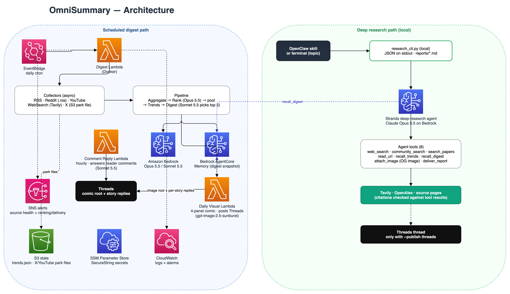
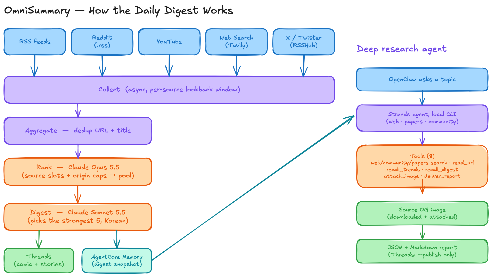

<div align="center">

# 🗞️ OmniSummary

**AI/ML 소식을 한국어 다이제스트와 4컷 만화로 Threads에 매일 올리고, 어떤 주제든 출처를 단 리포트로 조사하는 딥 리서치 CLI를 함께 제공한다.**

AWS · Amazon Bedrock(Claude, GPT) · Bedrock AgentCore Memory

[](https://github.com/bits-bytes-nn/omnisummary/actions/workflows/ci.yml)


🇺🇸 [English README](./README.md) · 🛠️ [운영 가이드](./docs/operations.md) · 📐 [설계 문서](./docs/design.md)



</div>

---

## 하는 일

OmniSummary는 서로 독립적인 두 부분으로 이뤄진다.

- **데일리 다이제스트(AWS, 정기 실행).** RSS와 Substack, Reddit, YouTube, X, 웹 검색에서 AI 소식을 모아 모든 항목을 채점하고, 에디터 모델이 그중 가장 좋은 기사 다섯 개를 고른다. 그다음 한국어 다이제스트를 쓰고 헤드라인을 한국어 4컷 만화로 그린다. 결과는 Threads 스레드 하나로 올라간다. 첫 글에는 만화와 리드, 나머지 기사 제목이 들어가고 기사마다 답글이 하나씩 달린다.
- **딥 리서치(로컬 CLI).** 주제를 주면 에이전트가 웹과 논문, 커뮤니티 논의를 찾고 1차 출처를 읽은 뒤, 다이제스트와 같은 말투로 출처를 단 한국어 리포트를 쓴다. 결과는 JSON 한 개로 출력하며 OpenClaw 스킬은 이 JSON을 그대로 읽는다. Threads 게시는 `--publish threads`를 줄 때만 한다.

켜 두면 한 시간마다 도는 작업이 최근 일주일 게시물에 달린 독자 댓글에 답하고, 스팸과 내용 없는 칭찬에는 답하지 않는다. 링크나 도메인, 다른 계정의 핸들, 해시태그가 들어간 답글은 게시하지 않는다. 댓글을 써서 계정이 남의 의도대로 말하게 만들 수는 없다.



## 빠른 시작

Python 3.12 이상과 [uv](https://docs.astral.sh/uv/), Bedrock을 쓸 수 있는 AWS 계정이 필요하다. Docker는 X 수집과 배포에만 쓴다.

```bash
git clone <repo-url> && cd omnisummary
uv sync --extra dev        # dev는 테스트, 린트, 타입 검사, CDK 도구를 더한다
cp config/config-template.yaml config/config.yaml
cp .env.template .env      # TAVILY_API_KEY를 채운다
```

AWS 자격 증명으로 `aws.bedrock_region`(기본 `us-west-2`)의 Bedrock에 접근할 수 있어야 한다. 모든 LLM 단계는 로컬 실행에서도 Bedrock에서 돈다. 이제 아무것도 저장하거나 게시하지 않고 다이제스트를 출력해 본다.

```bash
uv run python main.py --dry-run --sources web_search
```

템플릿에는 피드와 서브레딧이 없지만 트렌드 검색은 들어 있어서, 처음부터 동작하는 소스는 웹 검색 하나다. 나머지는 하나씩 켠다.

| 원하는 것 | 설정 | 비고 |
|-----------|------|------|
| RSS, Reddit, YouTube | `config.yaml`의 피드, 서브레딧, 채널 | `YOUTUBE_API_KEY`는 선택(없으면 채널 RSS를 쓴다) |
| YouTube 자막, X 게시물 | 아래의 로컬 동기화 | 둘 다 데이터센터 IP를 막는다 |
| 데일리 만화 | `OPENAI_API_KEY` | `gpt-image-2.5-sunburst`가 그린다 |
| Threads 게시 | `THREADS_ACCESS_TOKEN`, `THREADS_USER_ID`, `pipeline.enable_threads_post: true` | 만화가 없으면 텍스트만 올린다 |
| 댓글 답글 | Threads 자격 증명과 `pipeline.enable_comment_replies: true` | `scripts/sample_comment_replies.py`로 게시 없이 답글 초안을 본다 |

## 사용법

```bash
# 다이제스트
uv run python main.py --dry-run --sources rss reddit    # 출력만
uv run python main.py                                   # 전체 실행: 저장, 만화, 게시(켜져 있을 때)

# 딥 리서치: stdout에 JSON 한 개, 리포트는 reports/ 아래
uv run python research_cli.py "<주제>"
uv run python research_cli.py "<주제>" --publish threads

# 다이제스트가 이미 게시한 내용(무료, 읽기 전용, JSON)
uv run python recall_cli.py digest 2026-10-26
uv run python recall_cli.py trends

# X와 YouTube 자막의 로컬 → S3 동기화
./scripts/sync_all_to_s3.sh
```

| `main.py` 옵션 | 효과 |
|----------------|------|
| `--sources rss reddit youtube web_search rsshub` | 이 소스만 수집한다(`rsshub`이 X다) |
| `--dry-run` | 다이제스트를 출력만 하고 저장도 게시도 하지 않는다 |
| `--top-n 5` | 기사 개수 |
| `--date 2026-03-28` | 다이제스트 날짜(기본: `aws.timezone` 기준 오늘, 기본값은 KST) |
| `--pin-url <url> [...]` | 이 URL을 기사에 반드시 넣는다 |
| `--force-republish` | 이미 게시한 날짜를 다시 게시한다 |

Threads 게시를 켜 둔 상태에서 이미 올라간 날짜로 실행하면 수집 전에 멈춘다. dry run과 `--force-republish`는 예외다. 미래 날짜의 `--date`와 모르는 소스 이름은 거부한다. `main.py`는 수집이 0건이거나, 다이제스트가 만들어지지 않았거나, Threads 게시가 다 올라가지 않으면 1로 끝난다(로컬에는 알림이 없다).

> 로컬에서 전체 실행을 해도 운영 데이터에 기록된다. 그날 스냅샷이 배포된 AgentCore Memory에 저장된다. 원장은 상태 버킷에 둔다. `STATE_BUCKET`을 지정하면 그 버킷, 아니면 `aws.state_bucket_name`이다. 둘 다 없으면 로컬 파일이라 운영에서 게시한 기록을 보지 못하고, 같은 날이 Threads에 두 번 올라갈 수 있다. 스택이 버킷을 직접 만들었다면(첫 배포 때 `aws.state_bucket_name`이 비어 있었다면) `.env`에 `STATE_BUCKET=<project>-<stage>-state`를 두고(`aws.s3_prefix`가 있으면 `S3_PREFIX=<s3_prefix>/digest_state`도) 로컬 실행을 그 버킷에 연결한다. `aws.state_bucket_name`에 넣으면 prod가 아닌 스테이지에서는 다음 배포 때 그 버킷이 삭제된다.

## 설정

비밀값이 아닌 설정은 모두 `config/config.yaml`에 둔다. 모든 설정 섹션은 모르는 키를 거부하므로, 코드에서 없어진 키는 `config.yaml`에서도 지운다. 주요 항목은 다음과 같다.

```yaml
pipeline:
  top_n: 5
  min_score: 0.6
  ranking_model: "anthropic.claude-opus-5-5"
  digest_model: "anthropic.claude-sonnet-5-5"   # 만화 에디터, 그라운딩, 댓글 답글도 이 모델을 쓴다
  trend_model: "anthropic.claude-sonnet-5-5"
  source_slots: {web: 1, x: 1, rss: 1, reddit: 1, youtube: 1}
  max_per_origin: 1
agent:
  model_id: "anthropic.claude-opus-5-5"         # 딥 리서치
```

모든 필드 설명은 [design.md §3](docs/design.md#3-설정)에 있다.

### 모델

모든 LLM 단계에 Claude나 GPT 모델을 쓸 수 있다. 둘 다 Bedrock이 같은 Converse API로 제공하므로 IAM 역할과 비용 추적 프로필도 그대로 쓴다. 해당 단계의 `*_model`(또는 `agent.model_id`)에 `shared/constants.py`의 ID를 넣으면 된다.

| 계열 | ID |
|------|----|
| Claude | `anthropic.claude-opus-5-5`, `anthropic.claude-sonnet-5-5`, `anthropic.claude-haiku-5-5`와 이전 모델 |
| GPT | `openai.gpt-6.1-sol`, `openai.gpt-6.1-terra` |

기본값은 실제 후보 풀로 측정해 정했다.

| 단계 | 기본값 | 근거 |
|------|--------|------|
| 랭킹 | Claude Opus 5.5 | Opus 4.8과 고른 결과의 차이가 다른 모델끼리 비교할 때와 비슷한 수준이고, 비용은 조금 낮다 |
| 다이제스트, 그라운딩, 만화 에디터, 댓글 답글, 리서치 사실 확인 | Claude Sonnet 5.5 | Opus가 넘겨 쓰던 분량 규격을 지키고, 비용은 절반 이하다 |
| 트렌드, 검색어 다듬기 | Claude Sonnet 5.5 | |
| 딥 리서치 | Claude Opus 5.5 | |

다이제스트 모델로 GPT-6.1 Sol과 Sonnet 5.5를 저장된 6일치(2026-10-21~10-26)로 비교했다. 맥락, 명료성, 정확성, 인사이트, Threads 글자 수 한도 준수, 한국어를 블라인드로 채점한 결과 Sonnet이 137점 대 133점으로 6일 중 4일을 이겼고, 출처에 없는 주장을 넣은 쪽은 GPT뿐이었다. 그래서 기본값은 Sonnet으로 두고, GPT는 설정만 바꾸면 쓸 수 있게 했다.

`shared/utils.py`의 등록부가 모델마다 받는 요청 형태를 적어 둔다. `temperature`는 토큰 수 계산용 Sonnet 4.6만 받는다. 기본 effort가 더 낮은 모델은 `high`로 고정한다(Claude는 `output_config`, GPT는 `reasoning`으로 보낸다). 강제 도구 선택은 되는 모델에만 쓴다. 리서치 에이전트는 Claude에서만 Converse 프롬프트 캐싱을 쓰고, GPT는 자체적으로 캐싱한다. Claude Fable 5.1은 등록하지 않았다. 계정의 기본 데이터 보존 모드에서 Bedrock이 이 모델을 거부한다.

### 비밀값

비밀값은 로컬에서는 `.env`에 둔다. AWS에서는 API 키와 Threads 자격 증명을 SSM Parameter Store에 두고, `ALERT_EMAIL`과 동기화 키는 `.env`에만 둔다. 꼭 필요한 것은 Tavily뿐이다. 다른 키는 각각 기능 하나를 켜고, 키가 없으면 그 기능은 로그 한 줄을 남기고 건너뛴다.

| 변수 | 켜는 기능 |
|------|-----------|
| `TAVILY_API_KEY` | 웹 검색과 리서치 CLI의 검색 |
| `YOUTUBE_API_KEY` | YouTube Data API(없으면 채널 RSS) |
| `OPENAI_API_KEY` | 데일리 만화 |
| `THREADS_ACCESS_TOKEN`, `THREADS_USER_ID` | Threads 게시(AWS에서는 토큰을 매주 갱신해 SSM에 쓴다) |
| `ALERT_EMAIL` | 이메일 알림. 배포에 필요하다. 없이 배포하면 구독이 지워진다 |
| `S3_SYNC_ACCESS_KEY_ID`, `S3_SYNC_SECRET_ACCESS_KEY` | 로컬 동기화 전용 키(선택) |

### RSSHub로 X 읽기

X는 로컬 [RSSHub](https://docs.rsshub.app/) 컨테이너로 읽는다. 로그인한 x.com 세션의 `auth_token`과 `ct0` 쿠키가 필요하다(브라우저 개발자 도구 → Application/Storage → Cookies → x.com).

```bash
docker run -d --name rsshub --restart unless-stopped -p 1200:1200 \
  -e NODE_ENV=production -e CACHE_TYPE=memory \
  -e TWITTER_AUTH_TOKEN='<auth_token>' -e TWITTER_CT0='<ct0>' \
  diygod/rsshub:latest
curl -s "http://localhost:1200/twitter/user/karpathy" | head   # 동작 확인
```

쿠키가 없으면 피드가 빈 채로 돌아온다. RSSHub 실패율이 오르면 쿠키를 새로 받아 컨테이너를 다시 만든다. 1200 포트에서 응답이 없으면 동기화 스크립트가 컨테이너를 띄운다.

## 다이제스트가 만들어지는 과정

단계별 상세와 각 설계의 이유는 [design.md](docs/design.md)에 있다.

1. **수집.** 수집기는 각자 정한 기간의 글을 동시에 모으고 상태(`OK`, `EMPTY`, `FAILED`, `STALE`, `DEGRADED`)를 보고한다. X와 YouTube 자막은 로컬에서 모아 S3에 적재하고, Lambda는 그 파일을 읽는다. 동기화는 다이제스트가 읽는 범위보다 넓게 적재하고 읽는 쪽은 직전 다이제스트가 읽은 정상 동기화 시점까지 거슬러 올라가므로, 동기화를 한 번 빠뜨리거나 늦게 돌리거나 일부만 성공해도 잃는 항목이 없다(이틀 연속이면 앞날은 잃는다).
2. **중복 제거.** 정규화한 URL(`youtu.be`나 `twitter.com` 같은 공유 링크 변형은 같은 항목으로 본다)과 제목으로 맞춘다. 겹치면 더 나은 쪽을 남긴다. 고정한 항목, 리트윗보다 원문, 더 긴 본문 순이다.
3. **랭킹.** Claude Opus 5.5가 기술적 깊이, 실무 가치, 새로움, 파급력, 연구 의의, 출처 권위로 채점하고 홍보성 글과 내용이 빈약한 글을 거른다. 최근 다이제스트 제목도 보므로 URL만 바꿔 돌아온 기사는 재탕으로 채점된다. `min_score` 이상인 후보가 최대 12개(`top_n` + `digest_candidate_buffer`)까지 다음 단계로 간다. 소스마다 가장 좋은 항목에 한 자리를 주고, 채널, 작성자, 사이트마다 한 항목까지만 받는다.
4. **트렌드 추적.** 모델은 오늘 항목을 기존 트렌드나 새 트렌드로 분류만 한다. 날짜, 활성·냉각 상태, 모멘텀, 상한은 `trends.json`을 다루는 일반 Python 코드가 맡고, 활성 트렌드 덕분에 다음 날 리드가 앞선 흐름을 이어 간다.
5. **작성.** 에디터가 주제가 겹치지 않는 가장 좋은 기사 다섯 개를 골라 리드와 기사별 제목, 본문, 시사점을 평문으로 쓴다. 이어서 근거 확인 단계(grounding)가 구체적 주장을 원문과 하나씩 대조한다. 글자 수 예산은 코드가 계산하므로 어떤 게시물도 Threads의 500자 한도를 넘지 않는다.
6. **렌더링.** 게시물 형태는 프롬프트가 아니라 코드가 정한다. 첫 글은 리드와 다른 기사들의 제목이고(답글 조회수는 루트의 2~5%다), 답글은 기사마다 하나이며, 주제 태그를 하나 단다.
7. **만화.** 별도 Lambda가 헤드라인을 2x2 만화로 그린다. 사실 하나를 그 일이 실제로 벌어지는 장면 그대로 그리고, 마지막 칸은 그 기사의 반전을 시각 개그로 보여 준다. 화자는 오너 페르소나 캐릭터이고 대사는 한국어다. 같은 Lambda가 Threads 게시도 맡으므로 만화 생성이 실패해도 글은 나간다.

> ⚠️ **DigestPrompt의 JSON 키 순서에는 의미가 있다.** `items`를 먼저, `lead`를 마지막에 요청해야 리드가 이미 쓴 기사들을 두고 논평한다(헤드라인 답글과의 단어 중복이 0.21~0.41에서 0.03~0.21로 줄었다). `DigestContent`의 필드 순서에 맞춰 키를 바꾸지 않는다.

## 딥 리서치

`research_cli.py`는 도구 8개를 스스로 조합하는 Strands 에이전트를 돌린다.

| 도구 | 하는 일 |
|------|---------|
| `web_search(query, news, time_range)` | Tavily 웹·뉴스 검색, 게시일 포함 |
| `community_search(query)` | Reddit, X, HN, Substack |
| `search_papers(query)` | OpenAlex: 날짜, 인용 수, 초록 |
| `read_url(url)` | 1차 출처의 전문 |
| `recall_trends()` / `recall_digest(digest_date)` | 다이제스트가 추적하고 게시한 내용 |
| `attach_image(source_url)` | 출처의 OG 이미지를 준비한다 |
| `deliver_report(report, channel)` | 리포트를 넘기거나 Threads에 게시한다 |

공개하기 전에 `deliver_report`가 스레드를 검사한다.

- 인용한 URL은 모두 도구 호출 결과로 나온 것이어야 한다.
- 출처를 하나 이상 인용해야 한다.
- 별도 모델이 인용한 출처를 읽고 출처가 뒷받침하지 않는 주장을 돌려보낸다. 고쳐 쓴 글도 매번 다시 검사한다(확인 호출 자체가 실패하면 확인 없이 게시한다).
- Threads 한도 안에 들어가야 하고, 넘치면 고쳐 쓰도록 돌려보낸다.
- 함께 올리는 이미지는 스레드가 인용한 페이지의 것이어야 한다.

OpenClaw 스킬(`~/.openclaw/workspace/skills/omnisummary-research/SKILL.md`)이 CLI를 호출하고 JSON 결과를 전달한다.

```json
{
  "status": "succeeded",
  "topic": "Mixture-of-Experts 추론 비용 — 최근 반년 동향",
  "title": "…",
  "markdown_path": "/…/omnisummary/reports/2026-10-11-180202-f1a02d61.md",
  "markdown": "# …",
  "sources": ["https://…"],
  "images": [],
  "threads": null,
  "model": "anthropic.claude-opus-5-5",
  "stop_reason": "end_turn",
  "usage": {"input_tokens": 0, "output_tokens": 0, "cache_read_input_tokens": 0, "cache_write_input_tokens": 0, "cycles": 0, "tool_calls": {}},
  "warnings": [],
  "error": null
}
```

두 CLI의 종료 코드는 `0` 성공, `1` 실패, `2` 입력 거부다(거부도 `status: "rejected"`인 JSON으로 돌려준다). `recall_cli.py`에서 `found: false`는 그 날짜에 저장된 것이 없다는 뜻이고, `status: "failed"`는 저장소를 읽지 못했다는 뜻이다. 로그는 stderr로 나간다.

## 일상 운영

[docs/operations.md](docs/operations.md)가 운영 가이드다. 하루 일정, 알림마다 뜻과 실행할 명령, 실패한 날을 저장된 스냅샷으로 다시 올리는 방법, 하지 말 것을 정리했다. 아무것도 게시되지 않은 날의 알림에는 실제 날짜가 채워진 재게시 명령이 함께 온다.

## AWS 배포

### 절차

시작하기 전에 `config/config.yaml`이 있어야 하고 `.env`에 `ALERT_EMAIL`이 있어야 하며, 아래 `<region>`은 `aws.region`과 같아야 한다. X나 YouTube 자막을 쓸 계획이면 첫 배포 전에 버킷을 직접 만들고 `aws.state_bucket_name`을 정한다. 로컬 동기화는 이 버킷에만 쓴다. 첫 배포 뒤에는 바꾸지 않는다. prod가 아닌 스테이지에서 바꾸면 스택이 만든 버킷이 삭제된다.

전역 `cdk`가 아니라 저장소에 고정한 CDK CLI(`npm install` 후 `npx cdk`)를 쓴다. 새 계정에서는 순서가 중요하다. Lambda가 이미지를 받는 ECR 저장소를 foundation 스택이 만들기 때문이다.

```bash
npm install
export AWS_PROFILE=<profile>

# 1. 계정·리전마다 한 번(아직 이미지가 없으므로 FOUNDATION_ONLY)
export FOUNDATION_ONLY=1
npx cdk bootstrap -a "uv run python scripts/deploy.py"

# 2. foundation 먼저: ECR 저장소를 만든다
npx cdk deploy '*-foundation' -a "uv run python scripts/deploy.py"
unset FOUNDATION_ONLY   # application 스택이 배포된 계정에서는 절대 설정하지 않는다

# 3. 이미지 빌드와 푸시
ECR_URI="$(aws sts get-caller-identity --query Account --output text).dkr.ecr.<region>.amazonaws.com/omnisummary-<stage>-agent"
aws ecr get-login-password --region <region> | docker login --username AWS --password-stdin "${ECR_URI%%/*}"
docker build --platform linux/amd64 --provenance=false -t "${ECR_URI}:latest" . && docker push "${ECR_URI}:latest"

# 4. 푸시한 이미지의 sha256 digest로 고정해 배포(없으면 deploy.py가 실행을 거부한다)
export DIGEST_IMAGE_REF=$(aws ecr describe-images --region <region> --repository-name omnisummary-<stage>-agent \
  --image-ids imageTag=latest --query 'imageDetails[0].imageDigest' --output text)
npx cdk deploy --all -a "uv run python scripts/deploy.py"

# 5. 비밀값과 비용 추적
uv run python scripts/put_secrets.py            # .env의 값을 쓴다. 읽기 전용 확인은 --verify
uv run python scripts/put_inference_profiles.py # 단계의 모델을 바꾼 뒤에도 다시 실행
```

이후 배포는 3, 4단계만 반복한다. 이미지 태그 문자열이 같으면 CloudFormation이 Lambda를 다시 배포하지 않으므로 이미지 digest(sha256)로 고정한다. `put_inference_profiles.py`는 설정의 `aws.profile`을 쓰므로 `AWS_PROFILE`과 같은 계정이어야 한다. zsh에서는 `"${ECR_URI}:latest"`처럼 중괄호를 쓴다. `$ECR_URI:l`은 zsh 수식어로 해석된다.

### 만들어지는 리소스

| 리소스 | 용도 |
|--------|------|
| Lambda: digest | 수집, 랭킹, 작성. 타임아웃 15분 |
| Lambda: visual | 만화를 그리고 Threads에 게시한다. 유일한 게시 경로이며 한 번에 하나씩 실행한다 |
| Lambda: Threads 토큰 갱신 | 매주 갱신한 토큰을 SSM에 다시 쓴다 |
| Lambda: 댓글 답글 | 매시간, 한 번에 하나씩 실행한다 |
| EventBridge | 매일 다이제스트(`aws.digest_cron_hour` / `digest_cron_minute`, **UTC** 기준. 기본 10:00 UTC는 19:00 KST)와 위 두 스케줄 |
| AgentCore Memory | 날짜마다 다이제스트 스냅샷 하나. 스택을 지워도 남는다 |
| S3 | 트렌드, 원장, 적재 파일, Threads 이미지 |
| SSM Parameter Store | 비밀값(SecureString) |
| SQS | digest와 visual Lambda의 DLQ |
| SNS + CloudWatch | 이메일 알림, 알람 10개(Lambda별 오류와 타임아웃 임박, 빈 다이제스트, DLQ) |
| ECR | Lambda 이미지. 최근 30개를 보관한다 |

모든 Lambda는 `retry_attempts=0`으로 돈다. Threads에는 멱등 키가 없어 자동 재시도로 같은 글이 두 번 올라갈 수 있기 때문이다. 실패는 DLQ에 쌓이거나 Errors 알람을 울린다.

### AWS의 비밀값

CloudFormation 템플릿은 SecureString을 담을 수 없다. 그래서 스택은 자리표시자 값으로 파라미터만 만들고, 배포 뒤 `scripts/put_secrets.py`가 실제 값을 쓴다. 재배포해도 덮어쓰지 않는다. 이 스크립트는 다음처럼 동작한다.

- 이미 SecureString인 파라미터는 건너뛴다. Threads 토큰은 그 자리에서 교체되기 때문이다(`--force`로 덮어쓴다).
- 변수가 비어 있으면 그 파라미터는 건드리지 않는다.
- 파라미터 하나가 실패해도 나머지를 계속 쓰고, 끝에 0이 아닌 코드로 종료한다.

비밀값 파라미터의 템플릿 속성은 태그를 포함해 추가하거나 바꾸지 않는다. 바꾸면 CloudFormation이 실제 비밀값 위에 자리표시자를 다시 쓴다. 테스트로 이 속성을 고정해 두었다.

### 비용 추적

Bedrock 온디맨드 사용량에는 태그를 달 리소스가 없다. `scripts/put_inference_profiles.py`가 설정한 모델마다 태그를 단 애플리케이션 추론 프로필을 만들고 모델을 호출할 때 이 프로필을 먼저 쓰므로, Cost Explorer에서 비용을 나눠 볼 수 있다(Billing에서 `Project` 비용 할당 태그를 활성화한다). 여러 단계가 한 모델을 공유하므로 호출마다 `LLM usage stage=... model=... input=... output=...` 로그도 남긴다.

### X와 YouTube의 로컬 동기화

X와 YouTube 자막은 데이터센터 IP를 막으므로 다이제스트 실행 직전에 로컬에서 모은다. 동기화는 `aws.state_bucket_name` 버킷에 쓰고, 이 키는 첫 배포 전에 정해 둬야 한다(AWS 배포 참고). 스택이 버킷을 만든 배포에 나중에 추가하지 않는다. X를 쓰려면 `collectors.rsshub.enabled: true`와 `accounts`도 설정한다. SSO 세션은 만료되므로 무인 cron에는 `.env`의 `S3_SYNC_*` 키를 쓴다.

```bash
crontab -e
# 18:30 KST, 19:00 KST(10:00 UTC) 다이제스트 30분 전. cron은 그 컴퓨터의 시간대를 따른다
30 18 * * * AWS_PROFILE=<profile> /path/to/omnisummary/scripts/sync_all_to_s3.sh >> /path/to/omnisummary/logs/sync.log 2>&1   # /tmp는 재부팅하면 지워진다
```

적재 파일이 `park_max_age_hours`(12시간. 정상이면 다이제스트 시점에 30분쯤 지났다)보다 오래되면 그 소스는 `STALE`을 보고하므로, cron이 멈춰도 정상처럼 보이지 않는다.

## 개발

```bash
uv run python -m pytest tests/             # 네트워크, AWS, 실제 비밀값 없이 돈다
uv run pre-commit run --all-files          # ruff, black, 파일 검사, uv lock --check
uv run mypy .
npx cdk synth -a "uv run python scripts/ci_synth.py"   # 고정한 CLI로 오프라인 synth
```

CI는 린트와 타입 검사, 저장소에 커밋된 설정 템플릿(`config/config-template.yaml`)으로 돌리는 오프라인 CDK synth, 커버리지를 포함한 테스트, 네트워크 없이 진입 모듈을 import하는 Docker 빌드, 의존성과 비밀값 스캔을 돌린다. `pip-audit --strict`는 잠금 파일에 새 보안 권고가 하나라도 생기면 빌드를 실패시킨다. `uv lock --upgrade-package <pkg>`로 고친다. 잠금 파일은 CI와 Dockerfile이 고정한 uv 버전으로 `uvx --from uv==0.6.14 uv lock`을 실행해 다시 만든다.

## 프로젝트 구조

```
omnisummary/
├── main.py            # 다이제스트 CLI
├── research_cli.py    # 딥 리서치 CLI(stdout에 JSON)
├── recall_cli.py      # 지난 다이제스트와 트렌드(stdout에 JSON)
├── collectors/        # RSS, Reddit, RSSHub(X), YouTube, 웹 검색, S3 적재 파일 로더
├── pipeline/          # 중복 제거, 랭킹, 트렌드, 다이제스트, 만화, 댓글 답글, 실행 흐름
├── agent/             # 리서치 에이전트와 도구, 이미지 생성, 다이제스트 상태
├── output/            # Threads 렌더링과 게시, 리서치 전달
├── shared/            # 설정, 모델, 프롬프트, 모델 등록부, 저장소, 리서치 백엔드
├── lambda_handlers/   # digest, visual, 토큰 갱신, 댓글 답글
├── infrastructure/    # CDK 스택
├── scripts/           # 배포, 비밀값, 추론 프로필, 동기화, 샘플러
├── assets/            # persona.jpg(화자 캐릭터 기준 시트)
├── config/            # config-template.yaml
├── tests/
└── docs/              # design.md와 다이어그램
```

## 라이선스

[MIT License](LICENSE)
