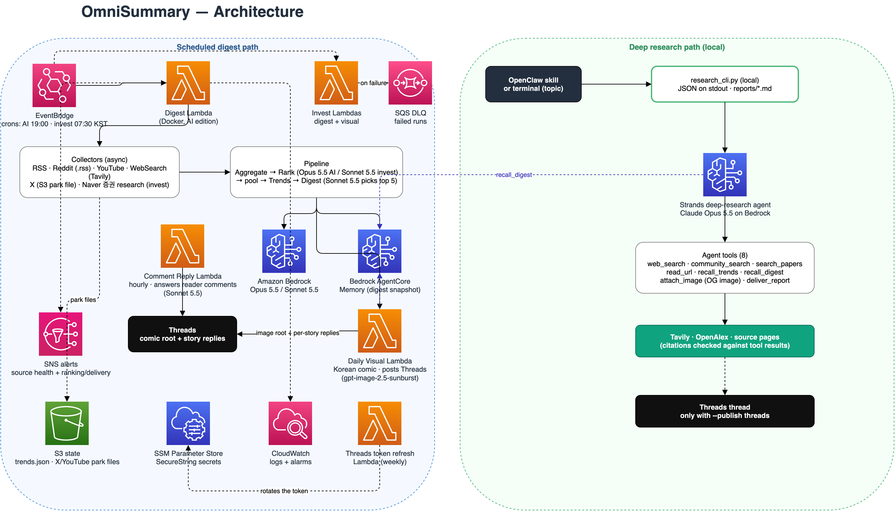
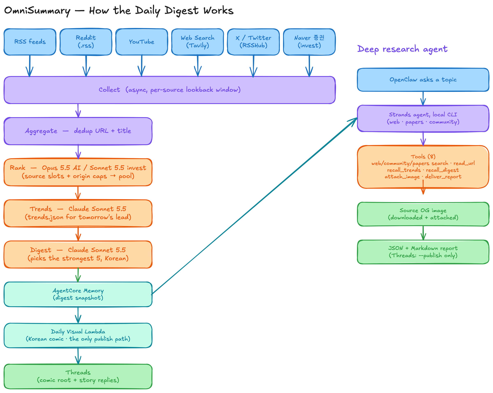

<div align="center">

# OmniSummary

**A daily AI/ML digest in Korean, posted to Threads with a comic of the headline, plus a deep-research CLI that writes cited reports.**

Runs on AWS · Amazon Bedrock (Claude, GPT) · Bedrock AgentCore Memory

[](https://github.com/bits-bytes-nn/omnisummary/actions/workflows/ci.yml)


[한국어 README](./README.ko.md) · [Operations guide (Korean)](./docs/operations.md) · [Design doc](./docs/design.md)



</div>

## What it does

- **Daily digest (AWS, scheduled).** Collects AI news from RSS/Substack, Reddit, YouTube, X and web search, scores every item, and lets an editor model pick the five best stories. It writes a Korean digest, draws the headline as a Korean comic, and posts one Threads thread: the comic, the lead and the other titles in the root, then one reply per story.
- **Deep research (local CLI).** Give it a topic and an agent reads the web, papers and community discussion, then writes a cited Korean report in the digest's voice. It prints one JSON object and posts to Threads only with `--publish threads`.
- **Comment replies (optional).** An hourly job answers readers' comments on the last week's posts. A reply with a link, domain, handle or hashtag is never posted.



## Quick start

You need Python 3.12+ with [uv](https://docs.astral.sh/uv/) and AWS credentials that reach Bedrock in `aws.bedrock_region` (default `us-west-2`). Docker is only for X and for deploying.

```bash
git clone <repo-url> && cd omnisummary
uv sync --extra dev
cp config/config-template.yaml config/config.yaml
cp .env.template .env      # set TAVILY_API_KEY

uv run python main.py --dry-run --sources web_search   # prints a digest; saves and posts nothing
```

Web search is the only source that works out of the box. Turn on the rest one at a time:

| To get | Set |
|--------|-----|
| RSS, Reddit, YouTube | Feeds, subreddits and channels in `config.yaml` (`YOUTUBE_API_KEY` optional) |
| X posts, YouTube transcripts | The [local sync](#local-sync-for-x-and-youtube) (both block datacenter IPs) |
| The daily comic | `OPENAI_API_KEY` |
| Threads posting | `THREADS_ACCESS_TOKEN`, `THREADS_USER_ID`, `pipeline.enable_threads_post: true` |
| Comment replies | The Threads credentials and `pipeline.enable_comment_replies: true` |

## Usage

```bash
# Digest
uv run python main.py --dry-run --sources rss reddit   # print only
uv run python main.py                                  # save, draw and post (when enabled)

# Deep research: one JSON object on stdout, the report under reports/
uv run python research_cli.py "<topic>"
uv run python research_cli.py "<topic>" --publish threads           # or threads-preview: no post
uv run python research_cli.py "<topic>" --edition invest            # markets, stocks, crypto

# What the digest already published (free, read-only)
uv run python recall_cli.py digest 2026-10-26
uv run python recall_cli.py trends
```

| `main.py` flag | Effect |
|----------------|--------|
| `--sources ...` | Collect only from `rss reddit youtube web_search rsshub naver_research` (`rsshub` is X; `naver_research` is the investing edition's Korean broker research) |
| `--dry-run` | Print the digest; save and post nothing |
| `--top-n 5` | Number of stories |
| `--date 2026-03-28` | Digest date (default: today in `aws.timezone`) |
| `--pin-url <url> [...]` | Force these URLs into the stories |
| `--force-republish` | Post again for a date that already went out |

`main.py` exits 1 when it collected nothing, produced no digest, or the post did not fully land.

> **A full local run writes to production.** The snapshot goes to the deployed AgentCore Memory. Set `aws.state_bucket_name` to the stack's bucket so local runs share its ledgers; without it they can't see what production posted, and a day may go out twice.

## Configuration

Everything that isn't a secret lives in `config/config.yaml`. Every section rejects unknown keys, so drop a key from your file when the code drops it. [design.md §3](docs/design.md#3-설정) describes every field.

### Editions

One codebase runs more than one edition. The investing edition (stocks, macro, crypto and Korean real estate) runs at 07:30 KST, the AI/ML one at 19:00 KST. To run it, `cp config/invest-template.yaml config/invest.yaml` and set `OMNISUMMARY_EDITION=invest` (the CLIs take `--edition invest`). It posts to the same Threads account but keeps its own S3 prefix (`omnisummary/invest`) and its own Lambdas.

### Models

Every LLM stage runs on Bedrock through the Converse API and takes any id from `shared/constants.py` (Claude, or GPT `openai.gpt-6.1-sol` / `-terra`). [design.md §6](docs/design.md#모델-팩토리) has the reasons and measurements.

| Stage | Config key | Default |
|-------|------------|---------|
| Ranking | `pipeline.ranking_model` | Sonnet 5.5 (the AI edition's config sets Opus 5.5) |
| Digest, grounding, comic, comment replies, research fact check | `pipeline.digest_model` | Sonnet 5.5 |
| Trends | `pipeline.trend_model` | Sonnet 5.5 |
| Search-query refinement | `collectors.web_search.refine_model` | Sonnet 5.5 |
| Deep research | `agent.model_id` | Opus 5.5 |
| Comic image | `pipeline.image_model` | `gpt-image-2.5-sunburst` |

### Secrets

Locally in `.env`; on AWS in SSM Parameter Store. Only Tavily is required; a missing key skips its feature with a log line.

| Variable | Turns on |
|----------|----------|
| `TAVILY_API_KEY` | Web search and the research CLI's searches |
| `YOUTUBE_API_KEY` | The YouTube Data API (channel RSS otherwise) |
| `OPENAI_API_KEY` | The daily comic |
| `THREADS_ACCESS_TOKEN`, `THREADS_USER_ID` | Threads posting (refreshed weekly on AWS) |
| `ALERT_EMAIL` | Email alerts; required to deploy |
| `S3_SYNC_ACCESS_KEY_ID`, `S3_SYNC_SECRET_ACCESS_KEY` | Optional keys for an unattended local sync |

### X through RSSHub

X is read through a local [RSSHub](https://docs.rsshub.app/) container with the `auth_token` and `ct0` cookies of a logged-in x.com session. Without them the feeds come back empty.

```bash
docker run -d --name rsshub --restart unless-stopped -p 1200:1200 \
  -e NODE_ENV=production -e CACHE_TYPE=memory \
  -e TWITTER_AUTH_TOKEN='<auth_token>' -e TWITTER_CT0='<ct0>' \
  diygod/rsshub:latest
```

## How the digest is made

1. **Collect.** Collectors run in parallel and report their health (`OK`, `EMPTY`, `FAILED`, `STALE`, `DEGRADED`). X and YouTube transcripts are collected locally and parked in S3 for the Lambda.
2. **Deduplicate** by normalized URL and title, keeping the better copy.
3. **Rank.** The ranking model scores each item and drops promos and thin posts. The candidate pool holds `top_n + digest_candidate_buffer` items, at most `max_per_origin` per channel, author or site.
4. **Write.** The editor picks the `top_n` strongest stories and writes a lead plus a title, body and takeaway for each. A grounding pass checks every claim against the source.
5. **Track trends.** After the write (and not on a dry run), the model sorts the day's stories into trends; dates and lifecycle are plain Python in `trends.json`.
6. **Render.** Code, not the prompt, lays out the posts within Threads' 500-character limit.
7. **Draw and post.** A separate Lambda draws the headline as a Korean comic and posts the thread. A failed render still ships the text.

[design.md](docs/design.md) explains each step and why it is shaped that way.

## Deep research

`research_cli.py` runs a Strands agent with eight tools: `web_search`, `community_search` (Reddit, X, HN, Substack), `search_papers` (OpenAlex), `read_url`, `recall_trends`, `recall_digest`, `attach_image` and `deliver_report`.

Before a thread goes public, `deliver_report` checks that every cited URL came from a tool call, that a separate model finds each claim supported by its source, that the thread fits Threads' limits, and that its image comes from a cited page. A failed check sends the thread back to be rewritten.

The OpenClaw skill (`~/Projects/agent-config/skills/omnisummary-research/SKILL.md`) relays the JSON, whose main fields are `status`, `title`, `markdown`, `markdown_path`, `sources`, `threads`, `usage` and `error`. Both CLIs exit `0` on success, `1` on failure and `2` on rejected input; logs go to stderr.

## Operations

[docs/operations.md](docs/operations.md) (Korean) is the operator's guide: the daily schedule, what each alert means, how to re-post a failed day from its stored snapshot, and what never to do.

## Deploying to AWS

### First deploy

You need `config/config.yaml`, `ALERT_EMAIL` in `.env`, and `<region>` set to your `aws.region`. Use the repo's pinned CDK CLI (`npx cdk`), not a global `cdk`. The foundation stack goes first because it owns the ECR repository.

```bash
npm install
# Steps 1-3 (CDK, aws, docker login) use the shell's profile; step 4's scripts read aws.profile.
# Point both at the same account: <profile> is your aws.profile.
export AWS_PROFILE=<profile>

# 1. Bootstrap and the foundation stack (no image exists yet)
export FOUNDATION_ONLY=1
npx cdk bootstrap -a "uv run python scripts/deploy.py"
npx cdk deploy '*-foundation' -a "uv run python scripts/deploy.py"
unset FOUNDATION_ONLY   # never set it once the application stack exists

# 2. Build and push the image
ECR_URI="$(aws sts get-caller-identity --query Account --output text).dkr.ecr.<region>.amazonaws.com/omnisummary-<stage>-agent"
aws ecr get-login-password --region <region> | docker login --username AWS --password-stdin "${ECR_URI%%/*}"
docker build --platform linux/amd64 --provenance=false -t "${ECR_URI}:latest" . && docker push "${ECR_URI}:latest"

# 3. Deploy, pinned to the image's sha256 digest
export DIGEST_IMAGE_REF=$(aws ecr describe-images --region <region> --repository-name omnisummary-<stage>-agent \
  --image-ids imageTag=latest --query 'imageDetails[0].imageDigest' --output text)
npx cdk deploy --all -a "uv run python scripts/deploy.py"

# 4. Secrets and cost attribution
uv run python scripts/put_secrets.py              # --verify for a read-only check
uv run python scripts/put_inference_profiles.py   # again after changing a stage's model
```

### Later deploys

```bash
scripts/release.sh
```

It builds, pushes and deploys the pushed, CI-green HEAD of `main`, and refuses a dirty tree, an unpushed HEAD or a red CI run. It takes the account from `aws.profile` in the config, not from the shell's `AWS_PROFILE`.

### What gets created

| Resource | Purpose |
|----------|---------|
| Lambda: digest | Collects, ranks and writes (daily, `aws.digest_cron_hour` in UTC) |
| Lambda: visual | Draws the comic and posts to Threads; the only publish path |
| Lambda: token refresh | Renews the Threads token weekly |
| Lambda: comment replies | Hourly |
| AgentCore Memory | One digest snapshot per date |
| S3, SSM, SQS, SNS, CloudWatch, ECR | State, secrets, dead-letter queue, alerts and alarms, the image |

Every Lambda runs with `retry_attempts=0`, because Threads has no idempotency key and a retry could post twice. Spend is attributed by tagged inference profiles and a `usd=` log line per call; `uv run python scripts/cost_report.py --days 7 [--by stage]` totals it.

> **Never add or change template properties on the SSM secret parameters.** CloudFormation would write the placeholder back over the live secret.

### Local sync for X and YouTube

X and YouTube transcripts block datacenter IPs, so sync them from your machine shortly before the digest runs. Set `collectors.rsshub.enabled: true` and its `accounts` for X, and `aws.s3_sync_user` when cron uses the `S3_SYNC_*` keys.

```bash
# crontab, in the machine's local time: 30 minutes before the 19:00 KST digest
30 18 * * * AWS_PROFILE=<profile> /path/to/omnisummary/scripts/sync_all_to_s3.sh >> /path/to/omnisummary/logs/sync.log 2>&1
# The investing edition (07:30 KST run)
0 7 * * * OMNISUMMARY_EDITION=invest AWS_PROFILE=<profile> /path/to/omnisummary/scripts/sync_all_to_s3.sh >> /path/to/omnisummary/logs/sync.log 2>&1
```

A park file older than `park_max_age_hours` (12h) reports `STALE`, so a stopped cron can't look healthy.

## Development

```bash
uv run python -m pytest tests/      # hermetic: no network, AWS or real secrets
uv run pre-commit run --all-files   # ruff, black, file checks, uv lock --check
uv run mypy .
uv run lint-imports                 # ports-and-adapters dependency direction
npx cdk synth -a "uv run python scripts/ci_synth.py"
```

Regenerate the lockfile with `uvx --from uv==0.6.14 uv lock`, the uv version CI and the Dockerfile pin.

The code follows ports and adapters. Dependencies point inward only, and CI checks it:

```
entrypoints/    Lambda handlers; bootstrap.py builds the adapters
adapters/       Bedrock, Threads, OpenAI images, S3 and AgentCore stores, collectors, research agent
application/    Use cases, ports (ports.py), prompts
domain/         Models, URL dedup, Threads post rendering, the digest snapshot
shared/         Config, constants, logger, pure helpers
infrastructure/ CDK stacks
scripts/        Deploy, secrets, sync, samplers
```

## License

[MIT License](LICENSE)
